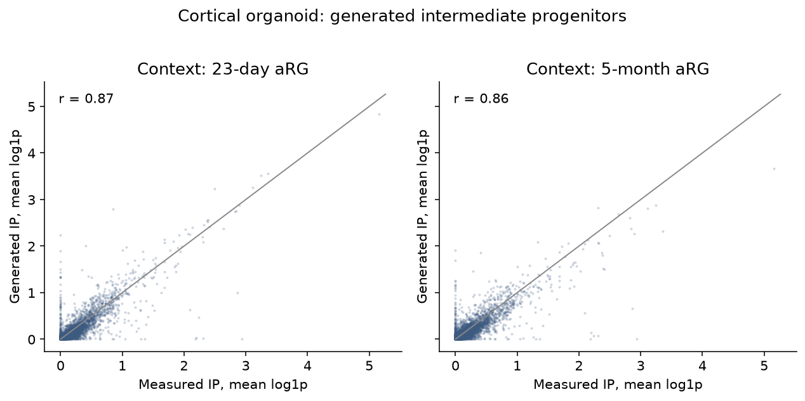
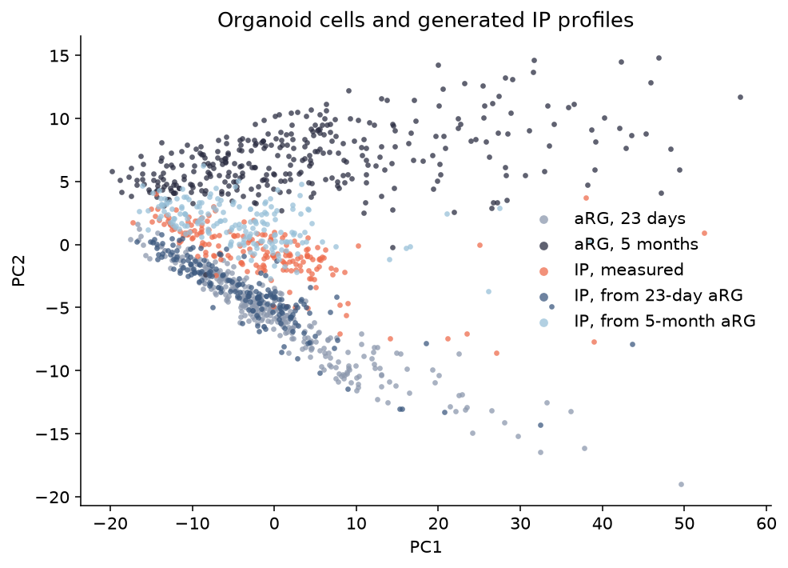
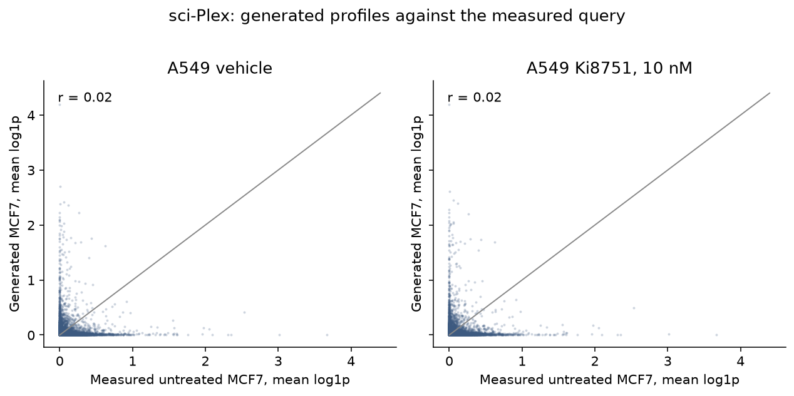
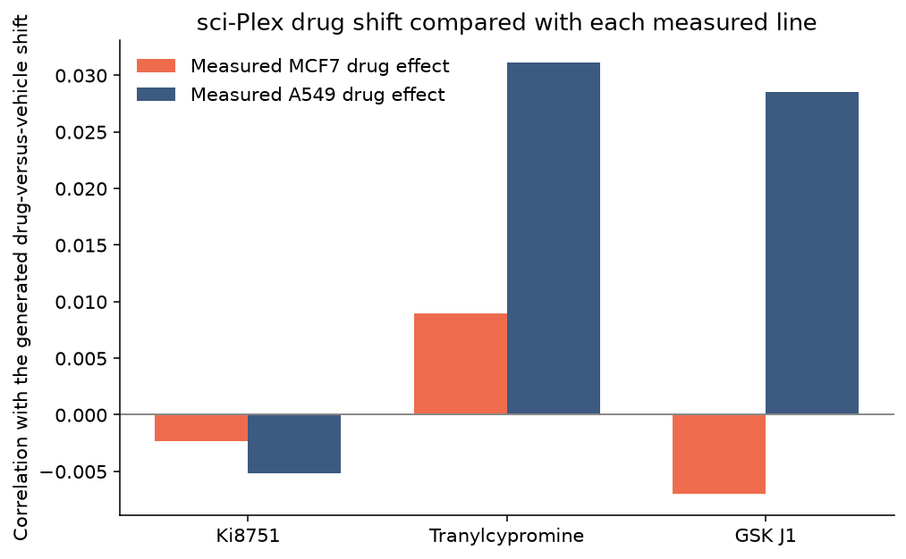

# STACK on the Engram datasets

We ran the published STACK model on the two single-cell datasets from the Engram meeting: the cortical organoid atlas (Group A) and the sci-Plex drug screen (Group B). STACK reads single-cell RNA counts, so the bulk dataset from that meeting was left out. We did not retrain it. We downloaded the published weights and asked it to rewrite one group of cells while looking at another.

## What we downloaded

Organoid counts are the raw matrices from the Uzquiano, Kedaigle, and Arlotta atlas (SCP1756 on the Broad Single Cell Portal), taken from the public study bucket. We used raw counts rather than the normalized tables, because STACK scales the data itself. Cell-type labels came from the cluster files shipped with the counts.

sci-Plex is GEO sample GSM4150378, the screen of A549, MCF7, and K562 cells. The cell table and gene names came from GEO. The GEO count file would not download here, so the counts came from the scPerturb release of the same experiment on Figshare. That file had lost its gene names, so we put the GEO names back and checked that known genes landed on the right columns.

The model is the published Stack-Large-Aligned checkpoint from Hugging Face, with the list of about 15,000 genes it reads.

## How the cells were divided

STACK uses a fixed window of 512 cells: about 333 are the example it may see, and about 179 are the cells it rewrites. We kept one window per group, a fixed random sample of real cells, so the run would finish on a CPU and stay repeatable. This is not the full atlas or the full screen.

Organoids used the earliest and latest ages that had both counts and cell types, 23 days and 5 months, after dropping labels that were not a real class. The example is the class with the most cells at 23 days, apical radial glia. The cells to rewrite are a different class present at both ages and most abundant at 5 months, the intermediate progenitor. Each age contributed 333 radial glia. All 179 intermediate progenitors come from 5 months, and those same cells were rewritten twice, once with each age of radial glia as the example.

For sci-Plex the cells to rewrite are untreated MCF7, and the example is A549: show a treated lung line, and ask what the breast line would look like. MCF7 has untreated cells only at 24 hours, so that is the only shared exposure with untreated cells in both lines. At 24 hours, 10 nM is the dose where the most compounds have at least 200 cells in both lines. We kept the three with the most cells in the scarcer line, Ki8751, tranylcypromine, and GSK J1, chosen for sample size rather than for a strong effect. The same 179 MCF7 cells were rewritten four times, with the A549 example set to untreated cells or to one of those compounds.

Each run writes one file of new counts for those 179 cells. Organoid files are split by age, and sci-Plex files are split by compound.

## What came out

The rewritten organoid cells still look like cortical progenitors. Agreement with the real intermediate progenitors is 0.87 (23-day radial glia) and 0.86 (5-month radial glia); the two rewrites agree with each other at 0.94. Leading genes match the measurement, including MALAT1 (65 of the top 100 shared), and counts per cell stay close. Cell by cell the match is about 0.4 to 0.5, because the model fills in a plausible count rather than copying the cell. On a plot of the cells, real intermediate progenitors sit between the two radial-glia ages, while each rewrite falls in with the age it was shown. EOMES, an intermediate-progenitor marker present in the real cells and missing in radial glia, is kept by the young example and mostly lost by the older one. VIM is turned up above the real progenitors in both rewrites, and TUBB3, absent in the measurement, is added by the 23-day example.

sci-Plex is single-nucleus RNA and looks unlike the organoid data: in these MCF7 cells MALAT1, GAPDH, and ACTB are essentially missing, and SACM1L leads. Agreement with the real untreated MCF7 cells is about 0.02 for every example, and the top 100 genes do not overlap. The four rewrites agree with each other at 0.99, so swapping the A549 example among untreated cells and the three compounds barely moves the result. The small shift matches neither the measured MCF7 drug effect nor the measured A549 drug effect, and in this sample of 200 cells per group the two real lines also do not share a drug shift.

On this one window, the organoid run stays inside a progenitor program and lets the example age pull the cells, and the sci-Plex run does not produce a recognizable MCF7 profile or the measured drug effect in either line.
